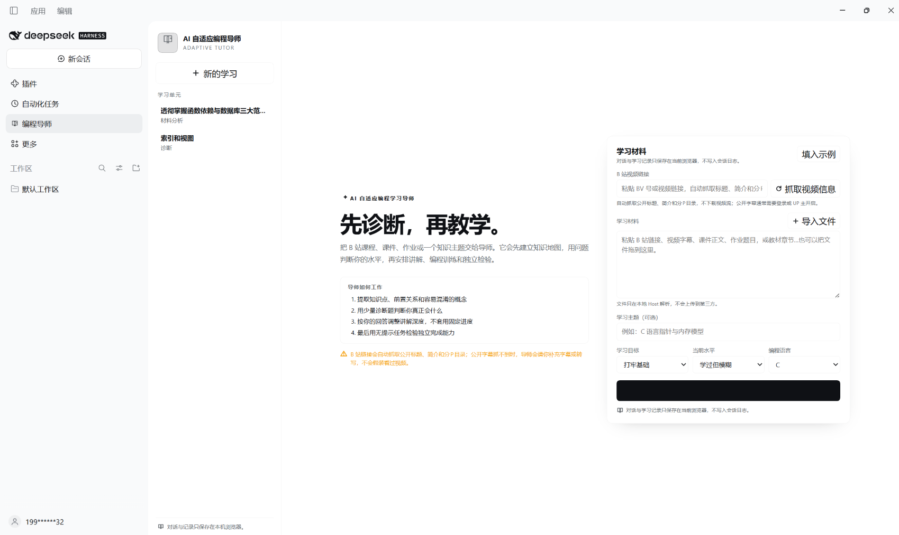
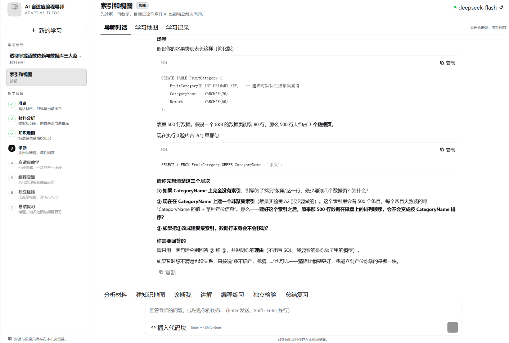

# AI 自适应编程导师（DSH 插件）

左侧栏入口 + 主面板的编程学习导师。它把 B 站课程、课件、作业或一个知识主题转成问题驱动的学习流程：材料分析 → 知识地图 → 诊断 → 自适应讲解 → 编程实践 → 独立检验 → 总结与间隔复习。

## 功能

- **左侧栏入口**：`sidebar.panellist` 中的书本图标，打开 `main` 面板 `cs-tutor`。
- **B 站自动抓取**：粘贴 BV 号或视频链接，Host 端抓取公开标题、UP 主、简介、分P目录和公开字幕/转写，自动填入学习材料。
- **文件拖拽导入**：把文件拖到材料卡片，或点“导入文件”；支持 txt / md / csv / json / html / docx / pptx / pdf 和常见代码文件。
- **导师对话**：调用当前 profile 的默认模型，服务端持有凭据；浏览器端使用插件自己的认证路由。
- **七个教学阶段**：阶段可在左侧栏切换，快捷按钮会发送对应的阶段指令。
- **学习地图**：保存材料分析产出的知识地图，展示学习简报和阶段路线。
- **编程实践**：对话中可直接粘贴代码；`插入代码块` 按钮会包上 Markdown 代码围栏。
- **学习记录**：A/B/C/D 掌握等级、错题/概念/掌握笔记、1/3/7/14/30 天间隔复习、Markdown 导出。
- **本地持久化**：对话、简报、笔记和复习计划保存在当前浏览器 `localStorage`，不写入 DSH 会话日志。

## 模型、抓取与数据

Host 端读取 `ctx.agentDefaultModel.currentSelection()`，通过 `ctx.llm.stream()` 调用模型；因此使用与 DSH 相同的模型登录和计费。没有配置模型时，页面会显示“模型未就绪”，但不会崩溃。

四条 Host 路由都经过 `ctx.connection.requestRejection()` 的浏览器认证检查：

- `GET /plugins/cs-tutor/status`
- `POST /plugins/cs-tutor/chat`（SSE）
- `POST /plugins/cs-tutor/ingest`（B 站公开信息/字幕）
- `POST /plugins/cs-tutor/extract`（拖拽文件文本提取）

B 站抓取只读取公开页面/API 的元数据与公开字幕，**不下载视频或音频流**。字幕接口在未登录时经常返回空列表，此时会保留标题、简介和分P目录，并提示补充转写。

## 诚实边界

- B 站链接会自动抓取公开标题、简介、分P目录和公开字幕；**不下载视频/音频流**。未登录或 UP 主未开启字幕时，字幕为空，导师会要求补充转写，不会假装看过视频。
- 拖拽支持 txt / md / csv / json / html / docx / pptx / pdf 和常见代码文件，单个文件上限 12 MB。PDF 为基础文本提取，扫描件、复杂公式或特殊字体可能缺失；旧版 `.doc/.ppt` 需另存为 `.docx/.pptx` 或粘贴正文。
- 本地只保存浏览器数据，不做跨设备同步。
- 如果 profile 未配置模型，对话不可用；材料/笔记/复习等本地功能仍可用。

## 安装

本目录是可直接安装的 bundle：

```text
plugin_manager install_bundle  target: <本目录绝对路径>
```

或从 GitHub 安装：

```bash
dsh plugin --profile desktop add github:<你的用户名>/<仓库名>
```

安装后刷新 Web GUI，左侧栏会出现“编程导师”入口。

## 仓库说明

上传 GitHub 时只需要本目录，不需要 `node_modules`、`.dsh` profile 或已安装的 junction。仓库根目录应直接包含 `package.json`、`index.js`、`ingest.js`、`client.js`、`cordis.patch.yml`、`locale/` 和 `icon.svg`。

## 效果演示


